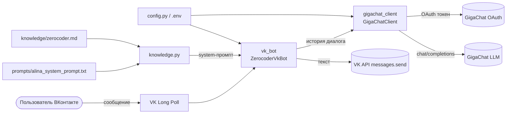

<div align="center">

# ZerocoderTest — чат-бот «Алина»

**Виртуальный консультант онлайн-университета Zerocoder для сообщества ВКонтакте.**
Ответы генерирует **GigaChat** на основе системного промпта и базы знаний о курсах.


</div>

---

## О проекте

**ZerocoderTest** — учебно-портфолио проект: чат-бот, который отвечает
пользователям сообщества ВКонтакте от имени **Алины**, консультанта
онлайн-университета [Zerocoder](https://zerocoder.ru/). Бот принимает
сообщения через **VK Long Poll** и генерирует ответы нейросетью
**GigaChat**, опираясь только на заранее подготовленную базу знаний о
курсах и строгие правила поведения из системного промпта.

Проект демонстрирует полный путь от идеи до рабочего сервиса:
интеграция двух внешних API, аккуратная работа с секретами, отделение
знаний от кода, обработка ошибок, тесты и CI.

## Демо

Пример диалога (факты берутся из `knowledge/zerocoder.md`):

> **Пользователь:** Привет! Хочу сменить профессию, но не знаю с чего начать.
>
> **Алина:** Здравствуйте! Помогу подобрать направление. Подскажите, какая
> сфера вам ближе — например, нейросети, аналитика или разработка? И сколько
> времени готовы уделять обучению?
>
> **Пользователь:** Интересуют нейросети. Учусь вечером после работы.
>
> **Алина:** Отличный вариант — курсы по работе с нейросетями: они рассчитаны
> на занятых людей и идут онлайн. Чтобы точно подобрать программу и подтвердить
> актуальную стоимость, удобнее оставить заявку — менеджер всё расскажет:
> https://zerocoder.ru/

## Возможности

- Приём сообщений сообщества ВКонтакте через **Long Poll**.
- Генерация ответов через **GigaChat API** (автообновление токена доступа).
- Ответы строго по **базе знаний** — бот не выдумывает факты.
- Мягкий возврат разговора к теме обучения, если пользователь уходит в сторону.
- Предложение формы связи с отделом продаж в подходящий момент.
- Память о контексте: до `MAX_HISTORY_TURNS` пар «вопрос-ответ» на диалог.
- Команды `/start`, `/reset` и приветствие по имени пользователя.
- Разбивка длинных ответов под лимит сообщения ВКонтакте (4000 символов).
- Защита от ответа самому себе (игнор сообщений сообществ).
- Автоматические тесты и CI на GitHub Actions.

## Архитектура



Подробнее — в [`docs/ARCHITECTURE.md`](docs/ARCHITECTURE.md).

## Технологии

| Слой | Технология |
|---|---|
| Язык | Python 3.10+ |
| Мессенджер | ВКонтакте, `vk-api` (Bots Long Poll) |
| LLM | GigaChat API (Sber), REST через `requests` |
| Конфигурация | `python-dotenv`, переменные окружения |
| Тесты | `pytest` |
| CI | GitHub Actions |

## Структура проекта

```
ZerocoderTest/
├── .github/
│   └── workflows/
│       └── ci.yml                 # CI: компиляция и тесты
├── bot/                           # пакет с логикой бота
│   ├── __init__.py
│   ├── gigachat_client.py         # клиент GigaChat (токен + генерация)
│   ├── knowledge.py               # сборка промпта и базы знаний
│   └── vk_bot.py                  # приём сообщений и ответы ВК
├── certs/
│   └── russian_trusted_root_ca_pem.crt   # корневой сертификат Минцифры
├── docs/
│   ├── ARCHITECTURE.md            # устройство проекта
│   └── GIT-WORKFLOW.md            # соглашения по ветками и коммитам
├── knowledge/
│   └── zerocoder.md               # база знаний о курсах
├── prompts/
│   └── alina_system_prompt.txt    # системный промпт Алины
├── tests/                         # модульные тесты (pytest)
│   ├── conftest.py
│   ├── test_config.py
│   └── test_knowledge.py
├── .env.example                   # шаблон переменных окружения (без секретов)
├── .gitignore
├── config.py                      # загрузка и проверка настроек
├── LICENSE                        # MIT
├── pytest.ini                     # настройки pytest
├── README.md
├── requirements.txt               # зависимости приложения
├── requirements-dev.txt           # зависимости для разработки и тестов
└── run.py                         # точка входа
```

## Быстрый старт

```bash
# 1. Клонировать репозиторий
git clone https://github.com/Yulya-com/ZerocoderTest.git
cd ZerocoderTest

# 2. Создать и активировать виртуальное окружение
python -m venv .venv
# Windows:
.venv\Scripts\activate
# Linux/macOS:
source .venv/bin/activate

# 3. Установить зависимости
pip install -r requirements.txt

# 4. Создать .env из шаблона и заполнить своими значениями
# Windows:
copy .env.example .env
# Linux/macOS:
cp .env.example .env

# 5. Запустить бота
python run.py
```

Бот подключится к Long Poll сообщества и начнёт отвечать на входящие
сообщения. Остановка — `Ctrl+C`.

## Настройка

Секреты в коде не хранятся. Все значения задаются в файле `.env`,
который исключён из Git. Полный список — в [`.env.example`](.env.example).

### Переменные ВКонтакте

| Переменная | Обязательна | Назначение |
|---|---|---|
| `VK_GROUP_TOKEN` | да | Токен доступа сообщества. Получить: **Управление сообществом → Работа с API → Создать ключ доступа**, включив право «Сообщения сообщества». |
| `VK_GROUP_ID` | да | Числовой ID сообщества (только цифры, без минуса). |

### Переменные GigaChat

| Переменная | Обязательна | Назначение |
|---|---|---|
| `GIGACHAT_AUTH_KEY` | да\* | Ключ авторизации из личного кабинета GigaChat API (Base64 от `ClientID:ClientSecret`). |
| `GIGACHAT_CLIENT_ID` | нет\* | Client ID. Альтернатива `GIGACHAT_AUTH_KEY`. |
| `GIGACHAT_CLIENT_SECRET` | нет\* | Client Secret (в паре с `GIGACHAT_CLIENT_ID`). |
| `GIGACHAT_SCOPE` | нет | Область доступа: `GIGACHAT_API_PERS` (по умолчанию), `GIGACHAT_API_B2B`, `GIGACHAT_API_CORP`. |
| `GIGACHAT_MODEL` | нет | Модель: `GigaChat-2` (по умолчанию), `GigaChat-2-Pro`, `GigaChat-2-Max`, `GigaChat-3-Ultra`. |
| `GIGACHAT_BASE_URL` | нет | Адрес API генерации (по умолчанию `https://api.giga.chat/v1`). |
| `GIGACHAT_OAUTH_URL` | нет | Адрес получения токена. |
| `GIGACHAT_VERIFY_SSL` | нет | Проверять SSL-сертификат (`true`/`false`). |
| `GIGACHAT_CA_BUNDLE` | нет | Путь к сертификату Минцифры (PEM/CRT). |
| `GIGACHAT_TEMPERATURE` | нет | Температура генерации (0..2). |

\* Нужно задать либо `GIGACHAT_AUTH_KEY`, либо пару
`GIGACHAT_CLIENT_ID` + `GIGACHAT_CLIENT_SECRET`.

### Настройки бота

| Переменная | Обязательна | Назначение |
|---|---|---|
| `MANAGER_FORM_URL` | нет | Ссылка на форму связи с отделом продаж. |
| `MAX_HISTORY_TURNS` | нет | Сколько пар «вопрос-ответ» бот помнит (по умолчанию 10). |
| `LOG_LEVEL` | нет | Уровень логирования: `DEBUG`, `INFO`, `WARNING`, `ERROR`. |

### Где получить ключ GigaChat API

1. Откройте проект **GigaChat API** в личном кабинете Studio.
2. Слева выберите **Настройки API**.
3. Нажмите **Получить ключ** (доступно ролям «Владелец» и «Администратор»).
4. Скопируйте **Authorization Key** и вставьте в `GIGACHAT_AUTH_KEY`.

Токен доступа бот получает и обновляет автоматически.

## Сертификаты Минцифры

Для GigaChat API нужен корневой сертификат Минцифры, иначе возникает
ошибка `CERTIFICATE_VERIFY_FAILED`. Варианты решения:

1. Установить сертификат в ОС (рекомендуется).
2. Указать путь к сертификату в `GIGACHAT_CA_BUNDLE`
   (в репозитории есть `certs/russian_trusted_root_ca_pem.crt`).
3. Отключить проверку SSL (`GIGACHAT_VERIFY_SSL=false`) — только для
   локальной отладки, в продакшене небезопасно.

## База знаний и промпт

- **База знаний** — `knowledge/zerocoder.md`. Бот загружает все файлы
  `.md`/`.txt` из папки `knowledge/` и добавляет их в системный промпт
  как единственный достоверный источник фактов. Чтобы обновить данные о
  курсах, отредактируйте файл — код менять не нужно.
- **Системный промпт** — `prompts/alina_system_prompt.txt`. Задаёт роль,
  характер и правила общения Алины. Плейсхолдер `{{MANAGER_FORM_URL}}`
  подставляется из `.env`.

## Тесты

```bash
pip install -r requirements-dev.txt
pytest -q
```

Тесты не обращаются к сети: проверяются загрузка конфигурации, сборка
базы знаний и подстановка системного промпта.

## CI и ветки

GitHub Actions (`.github/workflows/ci.yml`) на каждый push и pull request
в `main`/`develop` прогоняет компиляцию и тесты на Python 3.10–3.12.

Модель ветвления — упрощённый Git Flow: постоянные `main` (стабильная
версия) и `develop` (интеграция), временные `feature/*`, `fix/*`,
`docs/*`, `release/*`, `hotfix/*`. Соглашения по веткам и коммитам —
в [`docs/GIT-WORKFLOW.md`](docs/GIT-WORKFLOW.md).

## Безопасность

- Реальные ключи и токены хранятся только в `.env` (в Git не попадает).
- В репозитории есть лишь шаблон `.env.example` без значений.
- Не публикуйте секреты в issues, чатах и скриншотах.

## Roadmap

- [ ] Хранение истории диалогов во внешнем хранилище (Redis/SQLite).
- [ ] Асинхронная обработка сообщений для роста нагрузки.
- [ ] Ограничение частоты запросов на пользователя.
- [ ] Docker-образ и `docker-compose` для деплоя.
- [ ] Расширение базы знаний и покрытия тестами.

## Лицензия

Проект распространяется по лицензии [MIT](LICENSE).

## Автор

**Yulya** — [@Yulya-com](https://github.com/Yulya-com)

Учебный проект в рамках курса Zerocoder. Оформлен как демонстрация
навыков: интеграция внешних API (VK, GigaChat), чистая архитектура,
работа с секретами, тесты и CI.
