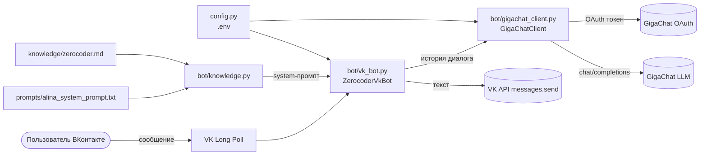
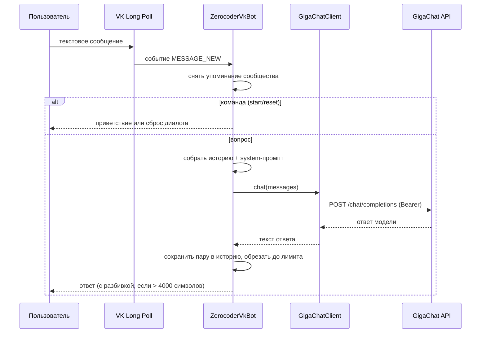

# Архитектура

Документ описывает, как устроен чат-бот «Алина», какие модули за что
отвечают и как проходит обработка одного сообщения.

## Общая схема

## Слои и ответственность

| Модуль | Роль | Ключевые сущности |
|---|---|---|
| `run.py` | Точка входа: сборка зависимостей и запуск | `main()`, `setup_logging()` |
| `config.py` | Чтение и валидация настроек из `.env` | `Config`, `ConfigError`, `load_config()` |
| `bot/vk_bot.py` | Приём сообщений сообщества и отправка ответов | `ZerocoderVkBot` |
| `bot/gigachat_client.py` | HTTP-клиент GigaChat: токен и генерация | `GigaChatClient`, `GigaChatError` |
| `bot/knowledge.py` | Сборка системного промпта и базы знаний | `load_knowledge()`, `build_system_prompt()` |
| `prompts/alina_system_prompt.txt` | Роль, правила и стиль Алины | плейсхолдер `{{MANAGER_FORM_URL}}` |
| `knowledge/zerocoder.md` | Единственный источник фактов о курсах | Markdown-файлы `.md`/`.txt` |

Зависимости направлены «в одну сторону»: `run.py` знает про `bot/*`,
`bot/vk_bot.py` знает про `GigaChatClient`, но клиент ничего не знает
про ВКонтакте. Это позволяет тестировать и заменять части по
отдельности.

## Последовательность обработки сообщения

## Ключевые решения

- **Токен GigaChat обновляется автоматически.** Клиент хранит токен и
  время его истечения, обновляет заранее (за 60 секунд) и повторяет
  запрос один раз при `HTTP 401`. Это убирает сбои на границе срока
  жизни токена (30 минут).
- **История диалога ограничена.** В памяти хранятся последние
  `MAX_HISTORY_TURNS` пар «вопрос-ответ». История хранится в
  `dict` по `peer_id`, поэтому диалоги разных пользователей не
  смешиваются.
- **Знания отделены от кода.** Факты о курсах лежат в `knowledge/`.
  Чтобы обновить данные, достаточно поправить Markdown-файл — код
  трогать не нужно.
- **Бот не падает от одного сообщения.** Обработка события обёрнута в
  `try/except` с логированием; при сбое GigaChat пользователю уходит
  вежливое сообщение со ссылкой на менеджера.
- **Секреты только в `.env`.** Код читает переменные окружения, а
  `.env` исключён из Git через `.gitignore`.

## Ограничения

- История диалогов хранится в оперативной памяти: при перезапуске бота
  контекст сбрасывается. Для сохранения между запусками нужен
  внешний store (Redis, БД).
- Обработка сообщений синхронная: одно событие обрабатывается за раз.
- Нет ограничения частоты запросов (rate limiting) на пользователя.
